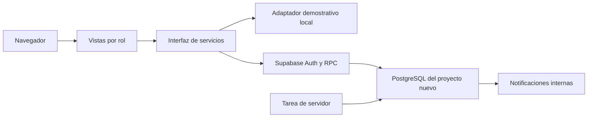
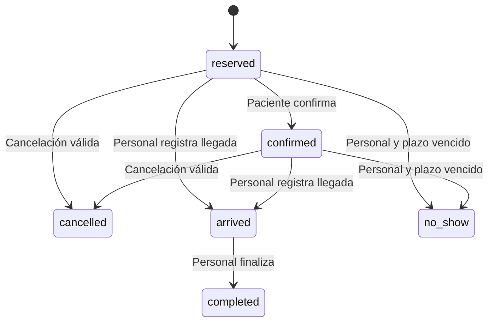

# Arquitectura de Medicita Contigo

## Componentes y límites

El adaptador demostrativo y el backend real comparten el contrato de operaciones, pero no comparten datos ni autenticación. Seleccionar un personaje de demostración no otorga permisos en Supabase.

## Organización modular

`main.js` coordina el arranque y la navegación. `pages/patient.js` y `pages/admin.js` despachan hacia módulos de reservas, espera, cuenta, agenda, recuperación, recursos e informes. Los componentes compartidos reciben contenido y acciones explícitas. Los servicios encapsulan autenticación, consultas, RPC y simulación. Las utilidades de fecha trabajan en `America/Santiago`, sin asumir la zona del dispositivo; rechazan horas locales inexistentes o ambiguas por cambio de horario.

La configuración pública identifica exclusivamente el proyecto Contigo nuevo. La aplicación valida su referencia antes de crear el cliente Supabase y utiliza una clave propia de almacenamiento de sesión. Un cambio de identidad invalida inmediatamente las solicitudes y los QR pendientes; la carga de datos se difiere fuera del callback de autenticación para evitar bloquear Supabase Auth.

La separación permite añadir un adaptador institucional autorizado en el futuro sin convertir las vistas en clientes de una API privada. No existe ningún adaptador conectado a Telesalud o agendas estatales.

## Datos

| Grupo | Finalidad |
|---|---|
| Perfiles y preferencias | Identificación mínima, rol y configuración de uso |
| Centro, servicios, profesionales y boxes | Configuración administrativa independiente |
| Horarios, excepciones y cupos | Disponibilidad e intervalos reales de atención |
| Reservas y eventos | Estado actual e historial responsable de cada transición |
| Espera y ofertas | Compatibilidad administrativa y aceptación de cupos |
| Notificaciones y entregas | Avisos internos, lectura e idempotencia de recordatorios |
| Auditoría y cancelaciones | Trazabilidad, liberación, reasignación y uso posterior |

La migración es la referencia exacta de nombres, columnas e índices. No se descarga el conjunto completo de tablas para cada usuario: `get_snapshot` aplica rol, intervalo de fechas, filtros y límites; `get_report` calcula agregados en servidor.

## Estados de la reserva

Reservar no equivale a asistir. La ausencia no se deduce de no responder un recordatorio. Las reglas y fechas se vuelven a validar en PostgreSQL.

## Operaciones críticas

Reservar o cambiar una hora se realiza mediante RPC y una transacción. Se valida disponibilidad, duración, cruces de profesional/box y conflictos del paciente. El cambio conserva la reserva anterior si falla cualquier validación. Cancelar libera el cupo una sola vez y guarda el evento. Aceptar una oferta comprueba propietario y vigencia antes de crear la nueva reserva.

La selección de candidatos considera servicio, rango, días, jornada, conflictos y preferencia de recibir ofertas. El orden entre solicitudes administrativamente equivalentes es su antigüedad; no calcula urgencia clínica.

## Mantenimiento y comunicación

Las ofertas vencidas dejan de impedir el uso del cupo según la hora del servidor. El mantenimiento idempotente genera avisos y procesa vencimientos; su ejecución periódica debe configurarse en el proyecto nuevo. Consultar una página o ejecutar un temporizador del navegador no sustituye una tarea programada del servidor.

`supabase/cron.sql` configura el trabajo de servidor `medicita-contigo-maintenance` cada cinco minutos. Está activo en el proyecto nuevo; las ejecuciones observadas se registran en [PRUEBAS](PRUEBAS.md). `public.run_maintenance()` está reservado al contexto de servidor, no a pacientes ni al selector de personajes de demostración.

Los avisos implementados son internos. Correo de acceso y recordatorios externos son sistemas distintos. Los adaptadores de correo, SMS o WhatsApp requieren proveedor, consentimiento, credenciales de servidor y verificación de entrega antes de anunciarse como activos.

## Informes

Ocupación mide cupos con reserva; asistencia mide estados de llegada/atención. Un cupo recuperado exige que, tras liberarse, otra persona complete la atención. La aceptación de una oferta se registra como reasignación y no basta para contar recuperación efectiva.
